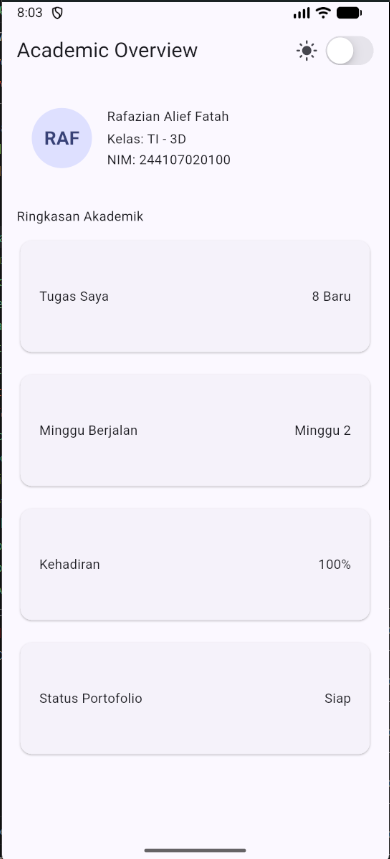
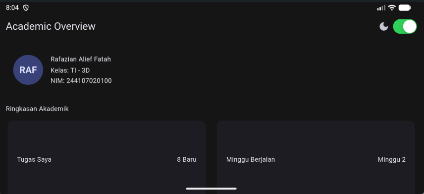
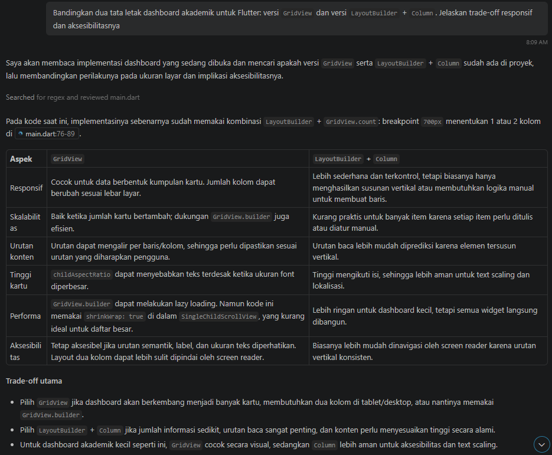

# Rafazian Alief Fatah - P2 - responsive_dashboard

## Tugas utama
Screenshot layar sempit (light mode)

Screenshot layar lebar (dark mode)

## AI Prompt Challenge
1. Prompt desain

2. Prompt penguatan konsep

.png)
.png)
.png)

3. Verification prompt

.png)
.png)
.png)

## Refleksi
- Apa perbedaan cara berpikir imperative dan declarative saat membangun UI?

Cara berpikir imperative berfokus pada bagaimana mengubah elemen UI langkah demi langkah secara manual, sedangkan cara berpikir declarative berfokus pada apa bentuk UI berdasarkan state (data) saat ini dan framework akan merender ulang tampilannya secara otomatis saat data berubah.

- Kapan Expanded membantu dan kapan penggunaannya justru menghasilkan layout error?

Expanded akan membantu saat mengisi sisa ruang yang tersedia secara proporsional di dalam Row atau Column yang memiliki batasan ukuran pasti. Widget ini akan menyebabkan layout error jika dimasukkan ke dalam elemen dengan infinite constraints karena dia tidak tahu batas maksimal ukurannya.

- Bagaimana breakpoint dan theme memengaruhi pengalaman pengguna?

Breakpoint membuat tata letak aplikasi tetap rapi dan theme menjaga konsistensi visual di seluruh bagian aplikasi, sehingga dapat menghasilkan UX yang lebih bagus.

- Apa yang Anda verifikasi dari rekomendasi AI setelah tugas inti selesai?

Prompt desain perbandingan tata letak versi GridView dan LayoutBuilder + Column, prompt penguatan konsep mengenai kapan penggunaan Expanded justru menyebabkan overflow dan contohnya, prompt verifikasi layout untuk memeriksa rekomendasi layout, dan prompt verifikasi penambahan .first pada find.byType(InfoCard) untuk test