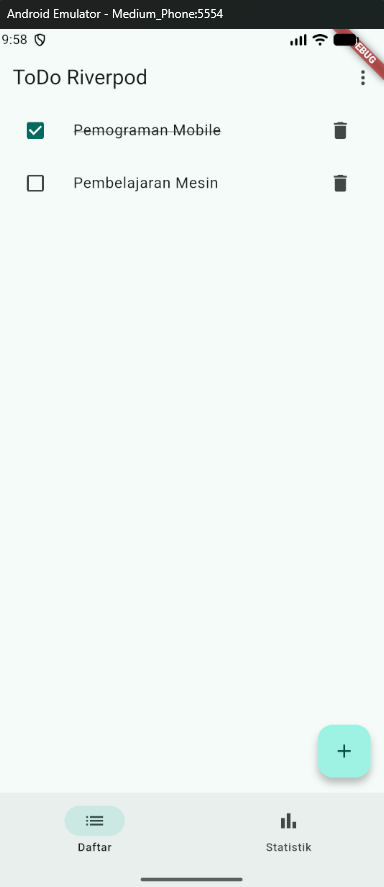
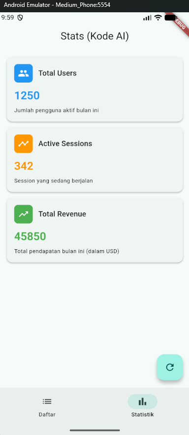
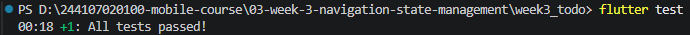

# Rafazian Alief Fatah - P3 - Navigation & State Management

## Tugas week3-todo
## Praktikum 2
### Hasil praktikum

## Praktikum 3
### Hasil praktikum

### No 2 (melempar error)

### Refleksi
#### Mengapa menampilkan ulang data lama (stale data) dengan indikator refresh kadang lebih baik daripada mengosongkan layar? Kapan pola itu penting?
Agar tampilan layar tidak tiba-tiba kosong saat refresh dan menghindari perubahan posisi elemen UI yang terlalu mendadak untuk tetap menjaga kenyamanan penggunanya. Pola ini penting jika aplikasi yang digunakan saat kondisi jaringan seluler yang kurang stabil.

## AI Challenge
### AI Prompt Challenge

### AI Verification Checklist
#### - Apakah state diubah secara immutable (tidak ada state.add() atau mutasi list langsung)?
Iya karena memakai async
#### - Apakah ref.watch hanya dipakai di dalam build, dan ref.read di callback?
Iya benar
#### - Apakah ketiga state AsyncValue benar-benar ditangani (bukan hanya success)?
Iya, menggunakan statsAsyncValue.when() dengan loading, error, dan data
#### - Apakah provider dideklarasikan dengan tipe eksplisit dan tidak duplikat dengan provider lain?
Iya benar dan tidak ada duplikat
#### - Apakah kode AI memakai API Riverpod versi lama (StateProvider antipattern, StateNotifierProvider usang, atau Consumer bertingkat yang tidak perlu)? Perbaiki ke pola Notifier/ConsumerWidget.
Kode AI memakai riverpod modern pattern
#### - Jalankan flutter analyze dan flutter test, apakah hasil AI lolos tanpa warning?
Iya lolos
### Hasil AI Prompt Challenge

## Refactoring dan Testing
 

## Refleksi
#### - Kapan setState masih cukup, dan kapan state harus naik ke Riverpod?
setState masih cukup saat state yang hanya dipakai di dalam 1 widget itu sendiri. Naik ke Riverpod pada saat state perlu diakses oleh beberapa widget yang berbeda
#### - Apa perbedaan context.go dan context.push, dan kapan masing-masing tepat digunakan?
context.go mengganti atau memindah seluruh route, sedangkan context.push menambah halaman baru di atas tumpukan route. context.go cocok untuk redirect login dan context.push cocok untuk halaman detail
#### - Bagaimana AsyncValue mencegah bug dibanding tiga boolean terpisah?
AsyncValue memastikan statenya selalu eksklusif, yang berarti hanya bisa berada di satu kondisi, yaitu data, loading, atau error
#### - Bagian mana dari hasil AI yang Anda perbaiki, dan mengapa?
Penggunaan StateProvider yang saya ganti ke NotifierProvider karena StateProvider termasuk API Riverpod versi lama