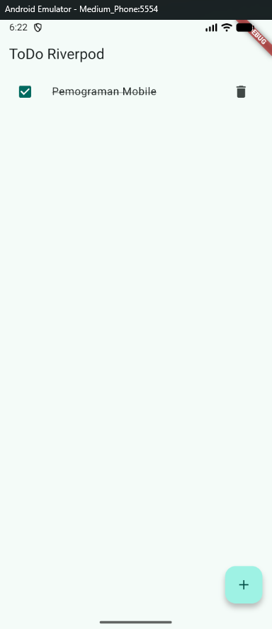
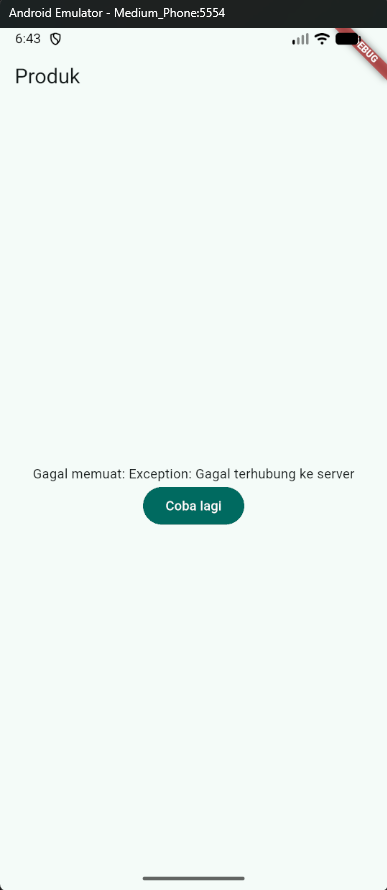
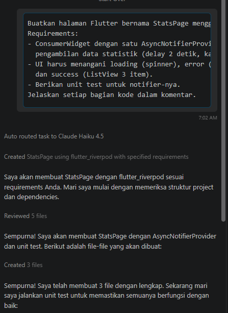
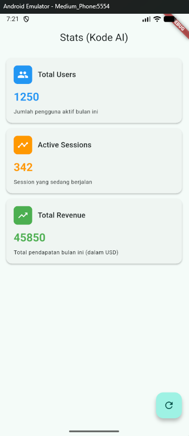

# Rafazian Alief Fatah - P3 - Navigation & State Management

## Tugas week3-todo
## Praktikum 2
### Hasil praktikum

## Praktikum 3
### Hasil praktikum

### No 2 (melempar error)

### Refleksi
#### Mengapa menampilkan ulang data lama (stale data) dengan indikator refresh kadang lebih baik daripada mengosongkan layar? Kapan pola itu penting?
Agar tampilan layar tidak tiba-tiba kosong saat refresh dan menghindari perubahan posisi elemen UI yang terlalu mendadak untuk tetap menjaga kenyamanan penggunanya. Pola ini penting jika aplikasi yang digunakan saat kondisi jaringan seluler yang kurang stabil.

## AI Challenge
### AI Prompt Challenge

### AI Verification Checklist
#### Apakah state diubah secara immutable (tidak ada state.add() atau mutasi list langsung)?
Iya karena memakai async
#### Apakah ref.watch hanya dipakai di dalam build, dan ref.read di callback?
Iya benar
#### Apakah ketiga state AsyncValue benar-benar ditangani (bukan hanya success)?
Iya, menggunakan statsAsyncValue.when() dengan loading, error, dan data
#### Apakah provider dideklarasikan dengan tipe eksplisit dan tidak duplikat dengan provider lain?
Iya benar dan tidak ada duplikat
#### Apakah kode AI memakai API Riverpod versi lama (StateProvider antipattern, StateNotifierProvider usang, atau Consumer bertingkat yang tidak perlu)? Perbaiki ke pola Notifier/ConsumerWidget.
Kode AI memakai riverpod modern pattern
#### Jalankan flutter analyze dan flutter test, apakah hasil AI lolos tanpa warning?
Iya lolos
### Hasil AI Prompt Challenge

