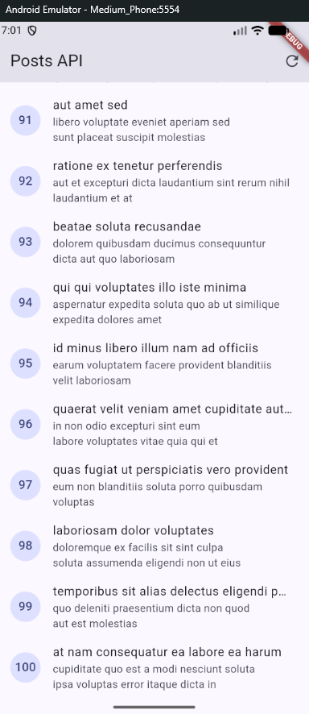
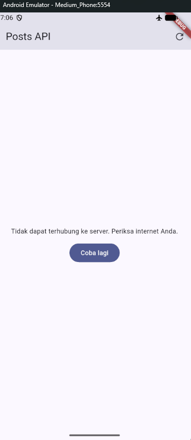
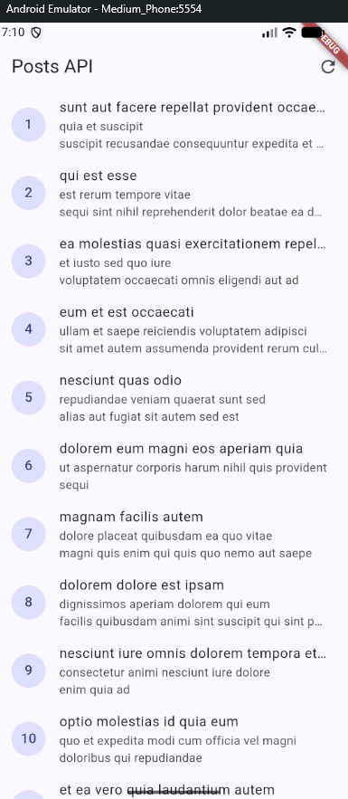
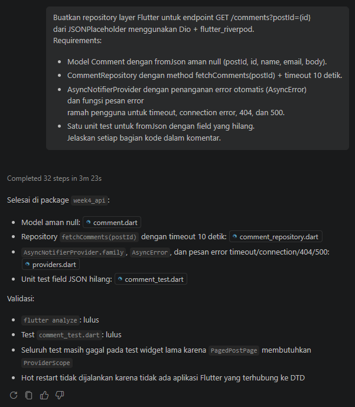
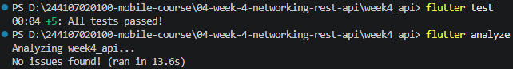

# Rafazian Alief Fatah - P4 - Networking & REST API

## Uji Skenario Error Praktikum 2
### 1. Jalankan aplikasi dengan internet normal, amati loading lalu daftar 100 posts.

### 2. Matikan internet (mode pesawat), tekan refresh, amati pesan ramah + tombol Coba lagi. Nyalakan kembali internet, tekan Coba lagi.

### 3. Sementara ubah baseUrl menjadi URL salah, amati pesan error koneksi. Kembalikan setelah uji.

## AI Challenge

### AI Verification Checklist
##### - Apakah UI memanggil Dio secara langsung (dilarang) atau lewat repository?
Lewat repository
##### - Apakah fromJson aman null, atau masih memakai cast langsung yang bisa crash?
Aman null
##### - Apakah semua tipe DioExceptionType (timeout, connectionError, badResponse) dipetakan ke pesan pengguna?
friendlyErrorMessage memetakan semua tipe DioExceptionType
##### - Apakah baseUrl/timeout terpusat di satu client, bukan tersebar di tiap method?
Terpusat pada api_client.dart
##### - Apakah test AI benar-benar menguji kasus field hilang, atau hanya happy path? Tambahkan minimal 1 edge case sendiri.
Ada test dengan field JSON yang hilang
##### - Jalankan flutter analyze dan flutter test, apakah hasil AI lolos tanpa warning?
Lolos semua

## Refactoring Challenge
- Ekstrak widget baris post menjadi PostTile tersendiri agar ListView.builder pendek dan mudah diuji.
- Pindahkan friendlyErrorMessage ke file lib/data/network_errors.dart agar bisa dipakai ulang halaman paged dan non-paged.
- Tambahkan halaman detail post dengan GoRouter (/post/:id) yang menampilkan title dan body lengkap, state detail diambil dari list yang sudah dimuat atau via repository bila langsung dibuka.
### Testing

## Refleksi
##### - Mengapa UI dilarang memanggil Dio langsung? Apa yang rusak jika aturan ini dilanggar?
Karena akan merusak Separation of Concerns dan Single Responsibility Principle. Yang rusak adalah coupling ketat ke HTTP library, pengujiannya, duplikasi kode dan parsing, dan manajemen status menjadi berantakan
##### - Kapan pagination client-side cukup, dan kapan harus mengandalkan pagination server (_page/_limit)?
Pagination client-side saja cukup saat dataset di bawah 100–500 item, datanya relatif statis, dan dapat diunduh sekaligus di awal tanpa mengganggu performa. Sedangkan pagination server dapat diandalkan saat menangani dataset berukuran besar, terus bertambah, atau berubah secara real-time
##### - Bagaimana exception repository berubah menjadi AsyncError tanpa try/catch di setiap widget? Kapan try/catch eksplisit tetap dibutuhkan?
Adanya mekanisme deklaratif dari manajer status modern seperti Riverpod. try/catch eksplisit tetap dibutuhkan pada aksi-aksi imperatif untuk memicu efek samping tanpa mengganti seluruh tampilan layar menjadi pesan kesalahan
##### - Bagian mana dari hasil AI yang Anda perbaiki, dan mengapa?
Tidak ada