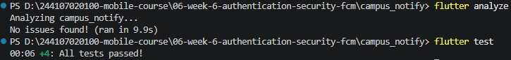

# Rafazian Alief Fatah - P6 - Authentication, Security & FCM

## Praktikum
### Memperbarui token

### Uji Notif


## AI Challenge
### Perbandingan penyimpanan untuk Offline Notes

Kebutuhan aplikasi ini terdiri dari dua jenis data yang berbeda: preferensi tema hanya berupa nilai kecil (misalnya `light`/`dark`/`system`), sedangkan catatan perlu CRUD, daftar yang dapat diurutkan/dicari, dan berpotensi berkembang menjadi relasi. Karena itu, penyimpanan preferensi dan catatan tidak harus memakai teknologi yang sama.

| Opsi | Kompleksitas query | Relasi | Reaktivitas (stream) | Type-safety | Boilerplate | Kemudahan testing | Trade-off / kecocokan |
|---|---|---|---|---|---|---|---|
| **SharedPreferences** | Sangat terbatas: baca/tulis nilai berdasarkan key; bukan untuk filter atau query daftar | Tidak ada | Tidak menyediakan stream perubahan data yang cocok untuk daftar catatan; perubahan perlu dikelola aplikasi | Tipe primitif dasar, tetapi key dan makna nilainya tidak dikompilasi sebagai model | Paling sedikit | Mudah diuji lewat wrapper/mock plugin; uji integrasi tetap bergantung pada plugin | Ringan dan sederhana untuk preferensi tema. Jangan menyimpan seluruh catatan sebagai JSON: update parsial, pencarian, migrasi, dan konsistensi menjadi tanggung jawab aplikasi. |
| **Hive** | Rendah–menengah: akses box/key dan filter objek di Dart; tidak ada SQL atau query relasional | Tidak ada foreign key/join; relasi dikelola sendiri | `box.watch()` memberi notifikasi perubahan box, tetapi pemetaan ke state aplikasi tetap perlu dibuat | Model dapat menggunakan adapter dan tipe Dart, tetapi validasi query tidak setara compile-time SQL | Rendah–menengah; perlu adapter untuk model kompleks | Box dapat diarahkan ke direktori sementara; pengujian relatif mudah | Nyaman untuk objek lokal dan operasi sederhana. Untuk pencarian/filter yang makin kompleks, aplikasi harus memuat/memfilter data sendiri; relasi dan migrasi skema lebih manual. |
| **sqflite (SQLite)** | Tinggi: SQL untuk filter, sort, pencarian, agregasi, transaksi, dan pagination | Mendukung foreign key dan join | Tidak menyediakan stream query otomatis; perlu memancarkan perubahan sendiri atau memakai solusi tambahan | SQL/model umumnya ditulis manual; kesalahan kolom dan mapping sering baru terlihat saat runtime | Menengah–tinggi: schema, mapping, migration, dan invalidasi state manual | Baik: gunakan database in-memory/temporary dan dependency injection untuk repository | Pilihan langsung dan fleksibel untuk SQL. Lebih banyak kode manual, dan menjaga agar UI tetap sinkron setelah setiap mutasi adalah tanggung jawab aplikasi. |
| **Drift** | Tinggi: SQL atau DSL bertipe, termasuk filter, join, transaksi, dan pagination | Mendukung relasi SQLite, foreign key, serta join | Stream query tersedia; hasil query diperbarui saat tabel terkait berubah | Kuat: API query dan hasil dibuat dari schema saat build, sehingga banyak kesalahan tertangkap lebih awal | Menengah: perlu deklarasi tabel dan code generation; lebih sedikit mapping/invalidasi manual dibanding sqflite | Sangat baik: database in-memory untuk test repository/query, tanpa database produksi | Direkomendasikan untuk catatan yang butuh query dan UI reaktif. Ada setup generator/build, tetapi memberi API terjaga tipe dan stream yang lebih terintegrasi. |

### Rekomendasi akhir

| Kebutuhan | Pilihan | Alasan |
|---|---|---|
| Preferensi tema | **SharedPreferences** | Nilainya kecil, berdiri sendiri, dan hanya perlu dibaca/ditulis berdasarkan key. SQLite/Drift akan menambah setup tanpa manfaat berarti. Bungkus akses dalam repository/service agar mudah diuji dan ganti implementasi bila diperlukan. |
| Catatan offline | **Drift (SQLite)** | Catatan memerlukan CRUD yang konsisten, pengurutan/filter/pencarian, pagination saat jumlah data bertambah, serta pembaruan UI melalui stream. SQLite menyediakan transaksi dan jalur untuk relasi; Drift mengurangi kesalahan query dan pekerjaan sinkronisasi manual dibanding sqflite. |

### Skema catatan untuk 1000+ item

Seribu catatan masih tergolong kecil bagi SQLite. Simpan satu catatan per baris, bukan satu dokumen JSON besar. Ambil data bertahap (`LIMIT`/`OFFSET`, atau keyset pagination untuk daftar yang terus berubah), dan tambahkan indeks hanya pada kolom yang benar-benar sering dipakai untuk filter/sort.

```text
+----------------------+       +----------------------+       +----------------------+
| notes                | 1   * | note_tags (opsional) | *   1 | tags (opsional)      |
|----------------------|-------|----------------------|-------|----------------------|
| id PK                |       | note_id PK, FK       |       | id PK                |
| title                |       | tag_id  PK, FK       |       | name UNIQUE          |
| body                 |       +----------------------+       +----------------------+
| created_at           |
| updated_at           |
| is_pinned            |
| is_archived          |
+----------------------+
```

Relasi tag bersifat opsional untuk fitur awal; tabel penghubung memungkinkan satu catatan memiliki banyak tag dan satu tag digunakan banyak catatan. Skema dasar SQLite yang dapat dinyatakan sebagai tabel Drift:

```sql
CREATE TABLE notes (
  id          INTEGER PRIMARY KEY AUTOINCREMENT,
  title       TEXT NOT NULL,
  body        TEXT NOT NULL,
  created_at  INTEGER NOT NULL,
  updated_at  INTEGER NOT NULL,
  is_pinned   INTEGER NOT NULL DEFAULT 0,
  is_archived INTEGER NOT NULL DEFAULT 0
);

CREATE INDEX idx_notes_updated_at ON notes(updated_at DESC);
CREATE INDEX idx_notes_pinned_updated
  ON notes(is_pinned DESC, updated_at DESC);
```

Simpan waktu sebagai epoch (misalnya milidetik UTC) secara konsisten. Indeks kedua membantu daftar pin/terbaru; bila query aktual tidak memakai filter pin, indeks itu dapat dihilangkan. Untuk daftar terbaru, query dapat memakai `ORDER BY updated_at DESC LIMIT 50 OFFSET ?`; untuk pencarian teks sederhana, `LIKE` cukup, sedangkan pencarian skala lebih besar dapat memakai SQLite FTS. `updated_at` dan indeksnya juga dapat membantu menyiapkan sinkronisasi, tetapi sinkronisasi multi-perangkat memerlukan metadata/status tambahan dan kebijakan konflik tersendiri.

### Trade-off pilihan

- **SharedPreferences:** paling sederhana untuk tema, tetapi bukan database catatan. Menaruh daftar catatan di sana membuat setiap perubahan membaca/menulis blob besar dan mengorbankan query serta migrasi terstruktur.
- **Hive:** praktis untuk model lokal dan watch box. Namun, filter biasanya dikerjakan di Dart dan relasi tidak dijaga database; tetap layak bila aplikasi memang hanya perlu akses objek sederhana dan tidak membutuhkan query SQL.
- **sqflite:** memberi kontrol penuh atas SQLite, transaksi, dan SQL. Imbalannya adalah mapping manual, migrasi, invalidasi cache/state, dan stream harus dirawat sendiri; cocok bila tim menginginkan SQL langsung tanpa code generation.
- **Drift:** menambah dependensi generator dan langkah build, tetapi query bertipe, hasil query reaktif, dan dukungan test in-memory mengurangi pekerjaan berulang untuk layar CRUD. Untuk kebutuhan catatan yang akan berkembang, manfaat tersebut lebih besar daripada setup tambahannya.

### AI Verification Checklist
#### - Apakah AI menempatkan daftar catatan di SharedPreferences? (menolak: rapuh untuk koleksi).
AI menolak penggunaan SharedPreferences untuk menyimpan daftar catatan karena menyimpan koleksi catatan sebagai JSON blob di SharedPreferences sangat rapuh, tidak efisien untuk update parsial, serta tidak mendukung querying maupun migrasi terstruktur
#### - Apakah skema AI mendukung antrean sync (dirty flag / updated_at) atau hanya CRUD polos?
Sebagian besar hanya CRUD polos
#### - Apakah klaim "real-time" AI didukung stream (Drift/watch) atau hanya asumsi?
Klaim AI menjelaskan bahwa Drift memiliki dukungan stream yang otomatis memancarkan data terbaru ke UI setiap kali terjadi perubahan tabel
#### - Apakah estimasi boilerplate AI masuk akal setelah Anda mencoba instalasinya (flutter pub add + migrasi skema)?
Estimasi AI masuk akal

## Refactoring Challenge
- Ekstrak baris catatan menjadi widget `NoteTile` tersendiri yang menampilkan badge "Belum tersinkron" bila `dirty == true`.
- Pindahkan logika cache posts dan `syncNotes` ke `lib/data/sync.dart` agar repository tetap fokus pada CRUD.
- Tambahkan halaman detail catatan dengan GoRouter (`/note/:id`) yang membaca dari repository lokal, bukan dari state halaman list.
### Testing


## Refleksi
#### - Mengapa daftar catatan tidak boleh disimpan di SharedPreferences? Apa yang rusak jika aturan ini dilanggar?
Karena SharedPreferences dirancang untuk key-value sederhana, bisa memicu pemborosan memori dan risiko file corruption jika terjadi crash saat proses tulis
#### - Kapan cache-first cukup, dan kapan Anda membutuhkan strategi lain (misalnya network-first untuk data harga real-time)?
Cache-first cukup saat menggunakan data yang jarang berubah atau di mana kecepatan render UI diprioritaskan di atas kebaruan data seketika. Network-first digunakan saat memerlukan akurasi real-time tinggi untuk data
#### - Bagaimana dirty flag berubah menjadi antrean sync tanpa memblokir UI? Kapan antrean terpisah (tabel outbox) menjadi perlu?
Saat pengguna membuat/mengedit catatan, data langsung disimpan ke SQLite lokal dengan status dirty = 1 dan UI diperbarui secara instan, lalu proses sync ke server berjalan di background thread dan setelah server merespons 2xx, status diubah menjadi dirty = 0 lalu UI di-refresh. Tabel outbox terpisah menjadi diperlukan ketika satu aksi membutuhkan riwayat operasi yang kompleks, seperti merekam urutan aksi, menangani rollback transaksi, atau ketika beberapa permintaan HTTP yang berbeda harus dikirim secara berurutan
#### - Bagian mana dari rekomendasi AI yang Anda tolak, dan mengapa?
Rekomendasi Drift karena penggunaan sqflite diperlukan untuk praktikum ini