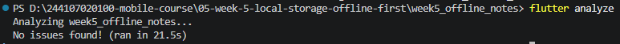
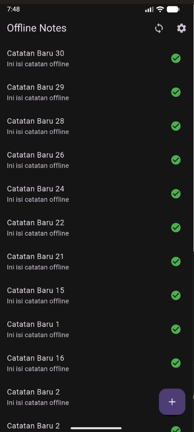
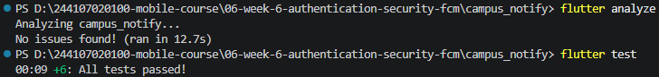

# Rafazian Alief Fatah - P7 - Clean Architecture

## Praktikum
### Notes App

## AI Challenge
### AI Challenge Verification (campus_notify)
#### - Apakah interface repository berada di domain dan implementasi di data?
Iya
#### - Apakah domain bebas import Flutter/Dio/SQLite/Firebase?
Iya, berdasarkan grep
#### - Apakah dibuat use case untuk tiap CRUD satu-baris?
Tidak untuk tiap CRUD, tetapi ada satu use case yang saat ini hanya meneruskan pemanggilan repository, yaitu get_notes
#### - Apakah entity bebas mapping?
Iya
#### - Apakah DI terpusat di provider dan widget tidak membuat repository sendiri?
Iya, provider fitur menghubungkan interface ke implementasi
#### - Keputusan final dan alasan teknis
Keputusan final diambil semua, karena penyesuaiannya sudah sesuai dan use case tidak untuk tiap CRUD

## Refactoring Challenge
### Testing

## Refleksi
#### - Mengapa interface repository harus tinggal di domain, bukan di data? Apa yang rusak bila dibalik?
Karena domain adalah pusat aplikasi (logika murni) dan tidak boleh bergantung pada paket eksternal atau UI, jika dibalik maka domain bergantung pada layer Data sehingga jika ada perubahan backend terpaksa membongkar ulang kode
#### - Kapan use case benar-benar dibutuhkan, dan kapan repository langsung ke notifier sudah cukup?
Saat ada orkestrasi atau logika bisnis kompleks seperti fitur login, repository langsung ke notifier sudah cukup jika operasi hanya bersifat CRUD tunggal / pass-through
#### - Apa biaya over-engineering (use case per CRUD satu-baris) bagi tim kecil? Kapan biayanya sepadan?
Membuang waktu development, context switching yang melelahkan karena harus buka 4-5 file hanya untuk menambah satu endpoint GET sederhana. Biayanya sepadan saat proyek berukuran raksasa, dikerjakan oleh banyak tim, atau aplikasinya memiliki logika perhitungan lokal yang tebal
#### - Bagian mana dari usulan AI yang Anda tolak atau sederhanakan, dan mengapa?
Sudah sesuai semua dengan verifikasi AI challenge sehingga belum ada yang ditolak